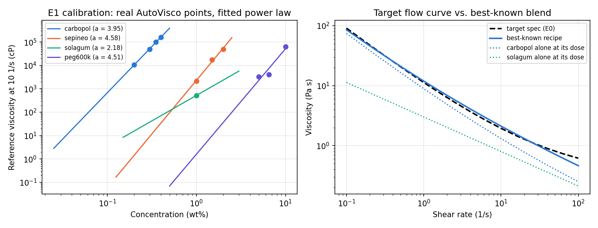

# Problem 1: Formulating a non-Newtonian blend to hit a target flow curve

**Type:** formulation / rheology · **Dimension:** 7 continuous · **Evaluation:** ~0.1 ms · **Data:** SDL5 AutoVisco and PEPV measurements; the objective is a physics model calibrated on them

## 1. The scientific problem

A self-driving formulation lab (SDL5) receives a product specification written as a **flow curve**: how viscous the product must be at every shear rate, from resting in a jar (0.1 s⁻¹) to being pushed through the Formulator Pen nozzle (100 s⁻¹). The lab has four thickeners on the shelf, each with a different rheological signature:

| Ingredient | What it does | Signature (measured on AutoVisco) |
|---|---|---|
| Carbopol 980 | cross-linked polyacrylic acid microgel | yield stress; only works once neutralized (pH ≳ 5) |
| Sepineo P600 | pre-neutralized acrylamide/acryloyldimethyl-taurate copolymer | strongly shear-thinning (n ≈ 0.34), pH-insensitive, hydrates in seconds |
| Solagum AX | acacia/xanthan gum | moderately shear-thinning (n ≈ 0.46 → 0.29 with concentration), pH-insensitive |
| PEG 600K | high-MW poly(ethylene oxide) | weakly shear-thinning, entangled scaling η ∝ c^4.5, slow to dissolve |

It can also add glycerol as a viscous co-solvent, set the pH, and choose how long the planetary mixer (Thinky ARE-312) runs. The question is the one a formulator answers every day: **which recipe reproduces the target flow curve, at the specified pH, cheaply and quickly?**

No single ingredient can do it. The target needs a yield stress (only Carbopol has one), shear thinning with n ≈ 0.45 and a high-shear viscosity floor (polymer contributions), all at pH 5.0 ± 0.5. That pH window is exactly where Carbopol is only partly neutralized and where PEG and un-ionized Carbopol form hydrogen-bonded complexes that *lower* viscosity.

## 2. Decision variables

| # | Symbol | Meaning | Units | Bounds |
|---|---|---|---|---|
| x0 | c_CBP | Carbopol 980 in final blend | wt% | [0, 0.5] |
| x1 | c_SEP | Sepineo P600 | wt% | [0, 2.5] |
| x2 | c_SOL | Solagum AX | wt% | [0, 3.0] |
| x3 | c_PEG | PEG 600K | wt% | [0, 10] |
| x4 | w_g | glycerol (co-solvent) | wt% | [0, 50] |
| x5 | pH | product pH (set by neutralizer) | – | [3.5, 10] |
| x6 | t_mix | planetary-mixer time | s | [10, 600] |

Water makes up the rest (always ≥ 34.5 wt%), so no simplex constraint is needed.

## 3. Equations

Shear-rate grid: γ̇_k, 16 points log-spaced over [0.1, 100] s⁻¹. Reference shear rate γ̇_ref = 10 s⁻¹.

**E0. Target spec.** A Herschel–Bulkley fluid with a high-shear floor:

  η_tgt(γ̇) = τ_y/γ̇ + K·γ̇^(n−1) + η_∞,  with τ_y = 8 Pa, K = 3 Pa·sⁿ, n = 0.45, η_∞ = 0.3 Pa·s

**E1. Concentration scaling of each thickener** (fitted to real data, §4):

  η_ref,i(c) = η0_i · (c / c0_i)^(a_i)  [cP at γ̇_ref]

**E2. Flow index vs. concentration** (fitted to real data):

  n_i(c) = clip( n0_i + b_i·ln(c / c0_i), 0.1, 1 )

**E3. Carbopol, Herschel–Bulkley.** The yield stress carries a fraction φ_y = 0.5 of the reference stress, so η(γ̇_ref) = η_ref:

  η_CBP(γ̇) = φ_y·η_ref·γ̇_ref/γ̇ + (1−φ_y)·η_ref·(γ̇/γ̇_ref)^(n_CBP−1),  n_CBP = 0.45

**E4. Other thickeners, power law:**

  η_i(γ̇) = η_ref,i(c)·(γ̇/γ̇_ref)^(n_i(c)−1)

**E5. Solvent viscosity.** Glycerol–water at 25 °C, Cheng (2008) correlation:

  η_s = η_w^α · η_g^(1−α),  α = 1 − C_m + a·b·C_m(1−C_m) / (a·C_m + b(1−C_m)),  a = 0.705 − 0.0017T,  b = (4.9 + 0.036T)·a^2.5

**E6. pH activation of Carbopol** (neutralization of carboxyl groups, and electrolyte collapse at high pH):

  f_pH,CBP = 0.02 + 0.98·σ((pH − 4.8)/0.3)·σ((9.8 − pH)/0.4);  f_pH = 1 for Sepineo, Solagum and PEG

**E7. Incomplete hydration.** A short mix leaves powder undissolved, and a viscous solvent slows hydration:

  h_i = 1 − exp(−t_mix / (τ_i·√(η_s/η_w))),  τ = {CBP 60 s, SEP 15 s, SOL 90 s, PEG 240 s};  c_eff,i = h_i·c_i

**E8. Blend rule.** Specific viscosities add in the common solvent (η_sp is measured relative to water, then scaled by the solvent's own viscosity). A pairwise term models the PEG–Carbopol complex:

  S_i(γ̇) = f_pH,i · max(η_i(γ̇; c_eff,i)/η_w − 1, 0)
  G(pH) = −1.8 · σ((5.5 − pH)/0.3)
  η_mix(γ̇) = η_s·[ 1 + Σ_i S_i + G(pH)·√(S_PEG·S_CBP) ]

**E9. Objective (minimize):**

  f(x) = √( mean_k [log10 η_mix(γ̇_k) − log10 η_tgt(γ̇_k)]² )  ← fit, in decades
     + 0.05 · cost($/kg)            cost = Σ c_i/100 · price_i, prices {CBP 30, SEP 25, SOL 20, PEG 15, glycerol 1.2} $/kg
     + 0.02 · t_mix/600 s
     + 0.5 · max(0, |pH − 5.0| − 0.5)²

A fit term of 0.045 means the blend misses the target by about 11% on average across the curve.

## 4. Data provenance

| File | Source | What it is |
|---|---|---|
| `data/autovisco_rheology_summary.csv` | **real** | AutoVisco (SDL5) per-sample summary: reference viscosities by concentration and power-law flow indices for Carbopol, Sepineo, Solagum, PEG and silicones |
| `data/ingredient_calibration.json` | fitted from real | E1/E2 constants per thickener, with the points each was fitted to |
| `data/pepv_silicone_blends.csv` | **real** | PEPV pump-viscometer measurements of 1 kcP/10 kcP silicone-oil blends at 8 ratios |
| `data/mixing_rule_validation.json` | fitted from real | Grunberg–Nissan fit to those blends: ideal log mixing misses by 9.8% on average; with the fitted interaction G = 0.66 it misses by 2.2%. This is the evidence that blends are non-ideal and need an interaction term |
| `data/target_flow_curve.csv` | spec | E0 on the shear grid |
| `data/reference_optimum.json` | computed | best-known optimum and how it was found |

Fitted constants (E1/E2):

| Ingredient | c0 (wt%) | η0 (cP) | a | n0 | b | Source |
|---|---|---|---|---|---|---|
| Carbopol | 0.2 | 10,491 | 3.95 | 0.45 (assumed) | – | 4 reference viscosities, 0.2–0.4% |
| Sepineo | 1.0 | 2,294 | 4.58 | 0.343 | −0.046 | 3 reference viscosities, 7 valid n fits |
| Solagum | 1.0 | 522 | 2.18 | 0.464 | −0.160 | 1 reference viscosity plus apparent-viscosity ratios, 3 n fits |
| PEG 600K | 5.0 | 2,261 | 4.51 | 0.450 | +0.211 | 3 reference viscosities, 2 valid n fits |

The exponents a ≈ 4–4.6 for Carbopol, Sepineo and PEG match the entangled semi-dilute scaling (η ∝ c^~4) expected from polymer physics. That is an independent sanity check on the real data.

**Assumptions (not from SDL5 data)** are all listed in `model.ASSUMED`: γ̇_ref = 10 s⁻¹ for the reference viscosities, Carbopol's yield fraction and n, the pH-activation curve, the PEG–Carbopol complexation strength, hydration times, and prices. These are literature-shaped and should be replaced by measurements as they become available.

## 5. Why this problem is hard

- **Strong nonlinearity:** concentration exponents of 2–4.6 put viscosity on a log scale over 4 decades, so the objective is ill-conditioned in linear concentration space.
- **Several competing recipes:** in 40 CMA-ES reference runs, 30 found the best basin (Carbopol + Solagum at pH 5.5), 8 a second basin (f ≈ 0.069) and 2 a Carbopol + PEG basin (f ≈ 0.085).
- **Flat and switching regions:** below pH ≈ 4.5 Carbopol contributes nothing, so its concentration has no effect there. The pH spec penalty is exactly zero inside the window and quadratic outside. PEG–Carbopol complexation switches on below pH 5.5.
- **Active bounds:** the best recipe sits on several bounds at once (no Sepineo, no PEG, no glycerol, pH at the spec edge). Methods that handle bounds poorly suffer.
- **Real trade-offs:** fit vs. cost vs. mixing time. The optimum mixes for about 160 s, not the maximum time.

## 6. Reference optimum (best-known)

f_opt = **0.067256**: fit 0.0448 (≈ 11%) + cost 0.0171 (0.34 $/kg) + time 0.0054. The recipe is 0.132% Carbopol + 1.51% Solagum, pH 5.50, mixed for 162 s. It was found by 40 CMA-ES runs of 20,000 evaluations each from random starts, each polished with L-BFGS-B (`data/reference_optimum.json`). Regret is reported against this value.



## 7. How to run

```bash
cd SDL_Real_Problem/01_nonnewtonian_blend
python build_data.py                     # rebuild every data file and f_opt (about 3 minutes)
cd .. && python run_baselines.py 01_nonnewtonian_blend --seeds 10 --workers 6
```

In code: `from task import make_task; t = make_task(); t.evaluate(x).y`, where `x` has length 7 within `t.bounds`.

## 8. Results (master-branch optimizers, budget 2000)

Regret is measured against f_opt = 0.067256, as the median over seeds. GP-BO and TuRBO were capped at 100 evaluations (`BUDGET_CAPS`). **BOBYQA is missing:** its campaign hung on Windows (Py-BOBYQA's threaded wrapper) and was stopped.

| rank | optimizer | budget | seeds | median best f | median regret | best seed | worst seed |
|---:|---|---:|---:|---:|---:|---:|---:|
| 1 | cma_es | 2000 | 10 | 0.06742 | 0.00016 | 0.06736 | 0.1360 |
| 2 | de | 2000 | 10 | 0.09170 | 0.0244 | 0.07964 | 0.1372 |
| 3 | nelder_mead | 2000 | 1 | 0.09502 | 0.0278 | – | – |
| 4 | random_search | 2000 | 10 | 0.1191 | 0.0519 | 0.09287 | 0.1469 |
| 5 | turbo | 100 | 10 | 0.1216 | 0.0544 | 0.07628 | 0.1614 |
| 6 | sobol | 2000 | 10 | 0.1262 | 0.0589 | 0.09000 | 0.1508 |
| 7 | lbfgsb | 2000 | 1 | 0.1291 | 0.0618 | – | – |
| 8 | gp_bo | 100 | 10 | 0.1333 | 0.0661 | 0.08811 | 0.1753 |

**Interpretation.** CMA-ES is the clear winner: its median seed reaches the best-known recipe to within 0.0002. But its worst seed (0.136) is stuck in a poor basin, so the problem's multimodality is real even for the best method. The gradient-based local methods do badly: L-BFGS-B ends worse than random search. The flat Carbopol-off region below pH 4.5, the kinks from `max(·, 0)` and the zero-penalty pH window break the assumptions of finite-difference gradients. With only 100 evaluations, the model-based methods (TuRBO, GP-BO) cannot learn a 7-D landscape spanning 4 decades. For an adaptive agent, this suggests: start with a global population method, and use the spread across restarts to detect basins.

Plots: [final regret](results/nonnewtonian_blend_d7/plot1_counterfactual_bar.png) · [regret vs evaluation](results/nonnewtonian_blend_d7/plot2_regret_vs_eval.png) · full table in [results/summary.md](results/summary.md).
