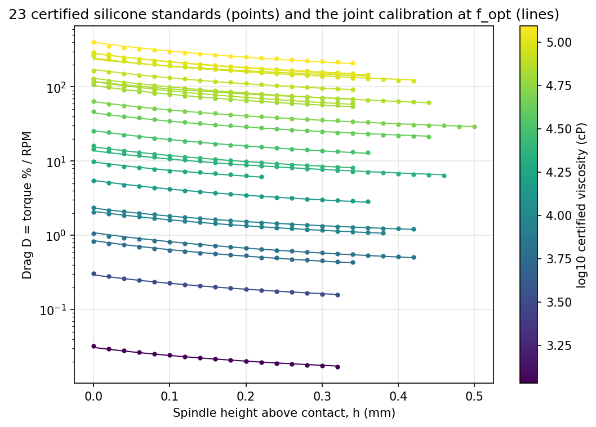

# Problem 2: Calibrating the gap-stepping cone-plate viscometer

**Type:** inverse problem / instrument calibration · **Dimension:** 26 continuous · **Evaluation:** ~0.015 ms · **Data:** 100% real measurements, with certified ground truth

> **Provenance.** Every input is a real measurement from the SDL5 viscometer. The objective evaluates the lab's own calibration equation on that data, and f_opt is computed by an offline search. The calibration is checked by leave-one-out on the same 23 standards; it has not been re-tested on new samples.

## 1. The scientific problem

SDL5's automated viscometer is a Brookfield DV2T-RV cone-plate spindle (R = 12 mm, 3° cone) mounted on a CNC stage. A conventional cone-plate measurement needs the cone tip set precisely at the plate, which a robot cannot do reliably for every sample. Instead, the SDL **steps the spindle down in 0.02 mm increments** from above the contact point and records torque at every height. Viscosity is then recovered from how the drag grows as the gap closes.

Turning that drag-vs-height curve into a viscosity needs a calibration model whose constants are shared across all fluids. That calibration is the problem here. It uses real data with a known right answer: 23 silicone oils with **certified viscosities** from 1.07 to 124 kcP.

## 2. Model

For standard j (certified viscosity μ_j in cP, run at a fixed RPM_j chosen to keep torque in range) at spindle height h_i (mm above contact):

  observed drag  D_ij = torque_ij(%) / RPM_j

  model drag   D̂_ij = k·μ_j^p / (h_i + h_c) + B_j

- **k·μ^p** is the amplitude of the near-contact drag singularity. It is shared by every fluid, and it is what makes viscosity recoverable from an unknown sample's curve.
- **h_c** (mm) is the effective gap offset, accounting for the truncated cone tip and the uncertainty in where contact is. It is also shared.
- **B_j** is a fluid-specific far-field drag (bearing friction, edge and meniscus effects), one per standard.

This is the model in `Automated_Viscometry/src/python_64/rheology_prediction.py`. The lab's current constants (`rheology_constants.py`) are k = 5.893·10⁻⁹, p = 2.007 and h_c = 0.2774 mm.

I also tested the generalized form A/(h + h_c)^q + B with q free, and rejected it: q trades off continuously against h_c (the objective falls monotonically from q = 2 to q = 0.1, with no interior optimum), so q and h_c cannot both be identified from this data. The problem keeps the lab's physical q = 1.

## 3. Decision variables

| # | Symbol | Meaning | Units | Bounds |
|---|---|---|---|---|
| x0 | log10 k | amplitude prefactor | – | [−11, −6] |
| x1 | p | viscosity exponent | – | [1, 3] |
| x2 | h_c | gap offset | mm | [0.01, 1.0] |
| x3…x25 | β_j | far-field offset of standard j, B_j = β_j·mean_i(D_ij) | – | [−1, 1] |

Each offset is scaled by its fluid's mean drag, because raw drag spans four decades (0.03 to 400 %/RPM).

## 4. Objective (minimize)

RMS relative drag error over all 448 measured points, in percent:

  f(x) = 100 · √( mean_ij [ (D̂_ij − D_ij) / D_ij ]² )

Relative residuals weight a 1 kcP oil and a 124 kcP oil equally, as a calibration across the whole range should.

## 5. Data (all real)

| File | What it is |
|---|---|
| `data/height_normalized.csv` | AutoVisco compiled calibration set: 23 certified silicone standards × up to 31 heights (0–0.60 mm), torque %. Column names encode `<nominal>kcp_<certified kcP>_torque_%_rpm_<RPM>`. Blank cells were trimmed before the contact point |
| `data/standards_long.csv` | the same 448 points in long format, with drag computed |
| `data/viscosity_validation.csv` | certified vs. predicted viscosity per standard: in-sample, leave-one-out, and with the lab's current constants |
| `data/reference_optimum.json` | f_opt, x*, method, and comparison with the lab's constants |

## 6. Why this problem is hard

- **26 dimensions with strong coupling:** k and p are almost perfectly correlated. μ spans two decades, so a change in p is nearly cancelled by a change in log10 k. That forms a long, narrow valley, the real-instrument analogue of Rosenbrock.
- **Every offset interacts with h_c:** each B_j trades off against the curvature that h_c controls, so the 23 offsets cannot be fitted independently of the 3 shared constants.
- **Very flat near the optimum:** the lab's hand-tuned constants (with optimal offsets) give 1.700%, against 1.654% at the optimum. The difference is small in f but visible in the recovered viscosities.
- **Structure a smart solver can exploit:** for fixed (k, p, h_c) the offsets have a closed-form weighted least-squares solution. A black-box optimizer has to discover the low-dimensional structure on its own, which is a fair test of whether an agent notices it.

## 7. Reference optimum and physical validation

f_opt = **1.65399%**, at log10 k = −8.2801 (k = 5.246·10⁻⁹), p = 2.0076 and h_c = 0.2583 mm. It was found by variable projection: closed-form offsets, 200 Nelder–Mead multistarts over (log10 k, p, h_c), then an L-BFGS-B polish in the full 26-D space.

The optimizer independently recovers the lab's empirical calibration: p = 2.008 against 2.007, and h_c = 0.258 mm against 0.277 mm.

Recovering the certified viscosities, by inverting each standard's own curve with the fitted constants:

| Calibration | Mean absolute error vs. certified μ |
|---|---|
| Joint fit at f_opt (in-sample) | 3.13% |
| Leave-one-out (constants refit without that standard) | 3.46% |
| Lab's current constants | 3.29% |

Leave-one-out stays close to in-sample, so the calibration generalizes to an unseen fluid rather than overfitting. The largest errors are on the 70 kcP (+11%) and 60 kcP (−6%) standards, which are also the noisiest curves.



## 8. How to run

```bash
cd SDL_Real_Problem/02_viscometer_calibration
python build_reference.py                 # f_opt, validation table, figure (about 2 minutes)
cd .. && python run_baselines.py 02_viscometer_calibration --seeds 10 --workers 6
```

## 9. Results (master-branch optimizers, budget 2000)

Regret is measured against f_opt = 1.65399% RMS error, as the median over seeds. GP-BO and TuRBO were capped at 100 evaluations (`BUDGET_CAPS`). **BOBYQA is missing:** its campaign hung on Windows (Py-BOBYQA's threaded wrapper) and was stopped.

| rank | optimizer | budget | seeds | median best f (%) | median regret | best seed | worst seed |
|---:|---|---:|---:|---:|---:|---:|---:|
| 1 | lbfgsb | 2000 | 1 | 1.724 | 0.070 | – | – |
| 2 | nelder_mead | 2000 | 1 | 8.058 | 6.40 | – | – |
| 3 | cma_es | 2000 | 10 | 13.33 | 11.7 | 9.444 | 20.09 |
| 4 | sobol | 2000 | 10 | 50.25 | 48.6 | 44.19 | 53.31 |
| 5 | random_search | 2000 | 10 | 51.22 | 49.6 | 43.06 | 53.98 |
| 6 | de | 2000 | 10 | 53.26 | 51.6 | 49.59 | 64.83 |
| 7 | turbo | 100 | 10 | 54.71 | 53.1 | 39.63 | 63.40 |
| 8 | gp_bo | 100 | 10 | 71.14 | 69.5 | 53.08 | 79.34 |

**Interpretation.** The ranking is almost the reverse of Problem 1. The landscape is smooth, so L-BFGS-B's finite-difference gradients work well: it reaches 1.72%, within 0.07 points of the optimum and roughly as good as the lab's hand-tuned constants (1.70%). The population and space-filling methods spend their 2000 evaluations across 26 dimensions and never find the narrow k–p valley: CMA-ES stalls at 13%, and DE and random search at about 50%. A calibration at 13–50% RMS error would be useless, so on this real problem the choice of method decides whether the instrument is calibrated at all. An agent that noticed the closed-form offsets (§6) could do far better than any black-box method.

Plots: [final regret](results/viscometer_calibration_d26/plot1_counterfactual_bar.png) · [regret vs evaluation](results/viscometer_calibration_d26/plot2_regret_vs_eval.png) · full table in [results/summary.md](results/summary.md).
