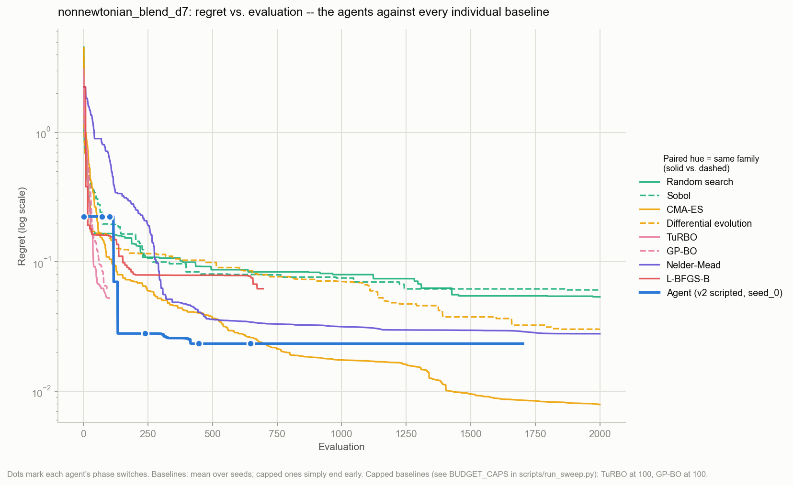
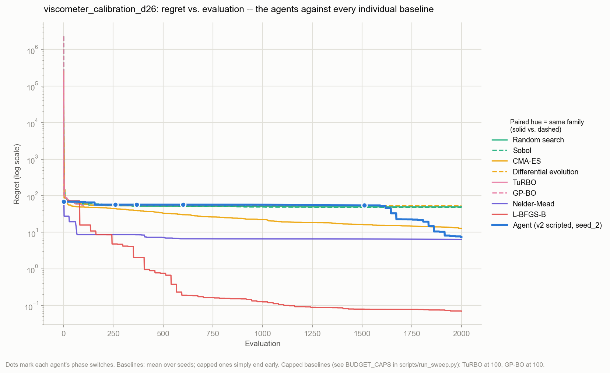
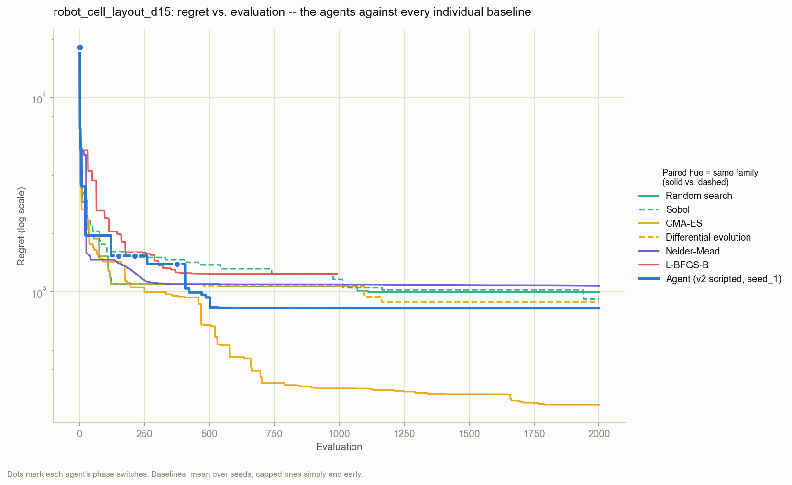

# SDL Real Problems: Cheapest Lunch on self-driving-lab science

Three optimization problems taken from real work in the SDL5 formulation lab, each written as a black-box task the "Cheapest Lunch" optimizer agent can run on. Each problem has a full definition (variables, bounds, equations, objective), its data from the SDL5 instruments and digital twin, a best-known reference optimum, and baseline results from the 9 optimizers on `master`.

| # | Problem | Science | Dim | Data | Eval cost | Landscape |
|---|---|---|---|---|---|---|
| [01](01_nonnewtonian_blend/PROBLEM.md) | Blend 4 thickeners + glycerol + pH + mix time to hit a target flow curve | formulation / rheology | 7 | AutoVisco calibration of 4 thickeners + PEPV blend measurements; physics model calibrated on them | ~0.1 ms | nonlinear (η ∝ c^2–4.6), 3 basins, flat pH regions, active bounds |
| [02](02_viscometer_calibration/PROBLEM.md) | Joint calibration of the gap-stepping cone-plate viscometer | instrument physics / inverse problem | 26 | 100% real: 23 certified silicone standards, 448 points | ~0.015 ms | narrow curved valley (k–p coupling), 23 coupled offsets, very flat optimum |
| [03](03_robot_cell_layout/PROBLEM.md) | Lay out the UR3e arm, CNC and grasp to minimize the mixer-loading cycle time | robotics / mechanical | 15 | cell geometry and UR3e kinematics from the `sdl_dt` digital twin (CAD/URDF) | ~2–6 ms | discrete IK branch switches, infeasible regions, non-smooth penalties |

Together they cover three different kinds of difficulty, which is the point for an agent that is supposed to choose and switch optimizers.

## What is measured and what is modeled

These are benchmark tasks: every objective value is computed in software. No recipe, calibration or layout found here has been tested in the lab.

| # | Measured inputs (real SDL5 data) | How f(x) is computed | Assumed or not yet validated |
|---|---|---|---|
| 01 | AutoVisco reference viscosities and flow indices for 4 thickeners; PEPV silicone-blend viscosities (used to check that mixing is non-ideal) | a physics model (power-law and Herschel–Bulkley ingredients, glycerol–water solvent correlation, blend rule) calibrated on those measurements | pH response, PEG–Carbopol interaction, hydration times, prices and the reference shear rate are literature-based assumptions (`model.ASSUMED`). The target flow curve is an illustrative spec, not a customer spec. No blend of these ingredients was measured |
| 02 | all of it: 448 torque readings on 23 certified silicone standards | the lab's own calibration equation evaluated on the measured data | the fit is checked by leave-one-out on the same 23 standards, not on new samples |
| 03 | cell geometry and UR3e kinematics from the `sdl_dt` digital twin (CAD/URDF) | a reduced kinematic model of the mixer-loading cycle (analytic IK, joint-space timing, sphere collision checks) | cycle times and clearances are model estimates, not timed on the robot. sdl_dt itself states its arm motion is not yet validated on hardware. The collision model is conservative by about 1–2 cm |

The reference optima are best-known values from offline searches, not proven optima (Problem 3's is not collision-free). The "agent" results come from the team's **scripted** v2 policy, not the LLM policy.

## Layout

```
SDL_Real_Problem/
├── run_baselines.py          shared runner: registers a problem's task with main/'s
│                             campaign loop and sweeps all 9 master optimizers
├── 01_nonnewtonian_blend/
├── 02_viscometer_calibration/
└── 03_robot_cell_layout/
    ├── PROBLEM.md            problem definition, equations, data provenance, results
    ├── task.py               make_task() -> src.tasks.base.Task (same interface as main/ tasks)
    ├── model.py / build_*.py the physics model, and the script that builds data/ and f_opt
    ├── data/                 input data and reference_optimum.json
    ├── figures/              problem figures
    └── results/<task>/       per-optimizer traces, plots, summary.md
```

## Reproduce

From the repository root (dependencies: `main/requirements.txt` plus pandas and matplotlib):

```bash
python SDL_Real_Problem/run_baselines.py 01_nonnewtonian_blend --seeds 10 --workers 4
python SDL_Real_Problem/run_baselines.py 02_viscometer_calibration --seeds 10 --workers 4
python SDL_Real_Problem/run_baselines.py 03_robot_cell_layout --seeds 10 --workers 4
```

Sweep settings match `main/scripts/run_sweep.py`: budget 2000; GP-BO, TuRBO and BOBYQA capped at 100 evaluations; deterministic methods (BOBYQA, Nelder–Mead, L-BFGS-B) run seed 0 only. All runs here were on Windows. `main/ADDING_TASKS.md` keeps `results_linux/` for Linux runs only, so these results stay inside each problem folder.

## Results

Median regret over seeds against each problem's best-known optimum; lower is better. GP-BO and TuRBO are at 100 evaluations, the rest at 2000.

| Method | 01 blend (f_opt 0.0673) | 02 viscometer (f_opt 1.654%) | 03 robot cell (f_opt 86.19)* |
|---|---:|---:|---:|
| **v2 scripted agent** (3 seeds) | 0.0233 | 7.33 | 823 |
| CMA-ES | **0.00016** | 11.7 | **243** |
| Differential evolution | 0.0244 | 51.6 | 923 |
| Nelder–Mead | 0.0278 | 6.40 | 1076 |
| Random search | 0.0519 | 49.6 | 1009 |
| TuRBO (100) | 0.0544 | 53.1 | not run |
| Sobol | 0.0589 | 48.6 | 970 |
| L-BFGS-B | 0.0618 | **0.070** | 1238 |
| GP-BO (100) | 0.0661 | 69.5 | not run |
| BOBYQA | – (hung on Windows) | – (hung on Windows) | not run |

\*Problem 3 is a reduced sweep: 3 seeds, 6 optimizers. Its f_opt is a penalized best-known value, because no fully collision-free layout has been found yet (see its PROBLEM.md).

**The winner flips between problems.** CMA-ES wins the multimodal formulation problem and the robot layout, where L-BFGS-B is close to the worst. L-BFGS-B wins the smooth 26-D calibration, where CMA-ES is 170× worse. No single method is safe for all three, which is the case for an agent that picks and switches methods.

**The team's v2 scripted agent** (`agent-v2` branch, no LLM; run with `run_agent.py`) is never the best and never the worst. It ranks 2nd on 01 and 03 and 3rd on 02. On 01, its probes classify the landscape as "smooth single basin" and send it to L-BFGS-B, which this problem punishes. On 02, it reads the probes as "several basins", spends 600 evaluations probing and about 900 on CMA-ES, and switches to L-BFGS-B, this problem's winner, only at evaluation 1510. These are concrete cases where a better switching policy would win. The LLM policy needs an API key that isn't set on this machine, so it was not run.

Figures in each `results/<task>/` folder, in the team's format: `plot1_counterfactual_bar.png`, `plot2_regret_vs_eval.png`, and `plot3_agent_method_timeline.png` (stars mark each agent decision, from `decisions.jsonl` → `changelog.md`). Regenerate with `python SDL_Real_Problem/make_plots.py`.

## Regret vs. evaluation, and the answer found

Each table compares the best-known optimum, the best point any baseline evaluated (method and seed in brackets) and the best point the v2 agent evaluated over its 3 seeds. Each is decoded into what it means in the lab. These are the tasks' computed answers. The Problem 1 recipes and Problem 3 layouts are model predictions that have not been made or run in the lab; the Problem 2 calibrations are fitted to measured data. Tables are generated by `python SDL_Real_Problem/report_answers.py`.

### 01: Non-Newtonian blend to a target flow curve



<!-- ANSWERS:01 -->
<!-- /ANSWERS:01 -->

All three answers share the same formulation idea: a low dose of Carbopol for the yield stress, one shear-thinning partner for the body, no glycerol, and pH at the top of the spec window, where Carbopol is most active. The best-known recipe and CMA-ES pair Carbopol with Solagum. The agent lands in a different basin, Carbopol plus Sepineo: cheaper and mixed faster (60 s), but a looser fit to the target. "Flow-curve error" is the average deviation from the target across 0.1–100 s⁻¹.

### 02: Viscometer calibration



<!-- ANSWERS:02 -->
<!-- /ANSWERS:02 -->

"Mean error vs certified μ" inverts each of the 23 standards' own drag curves with that solution's calibration constants and compares with the certified viscosity. This is the number that matters in the lab. The 23 per-fluid offsets are part of each solution but are omitted here.

### 03: Robot cell layout



<!-- ANSWERS:03 -->
<!-- /ANSWERS:03 -->

Positions are in the mixer frame. A negative min clearance means some part of the arm passes inside the conservative collision envelope. No layout found so far is collision-free, so these are the least-colliding reachable layouts found. The IK branch flags are part of each solution but are omitted here.

## Using these with the agent

Each `task.py` can be wrapped as a blind harness in the same way as `main/src/agent_harness/task_<NNN>.py`. Copy the objective, not the `f_opt`, and build a sandbox with `main/scripts/make_sandbox.py`. The `PROBLEM.md` files name the science in full, so **do not ship them into an agent sandbox**. A blind brief should state only the dimension, bounds and budget.
