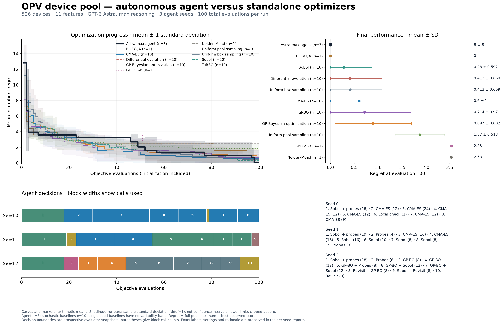
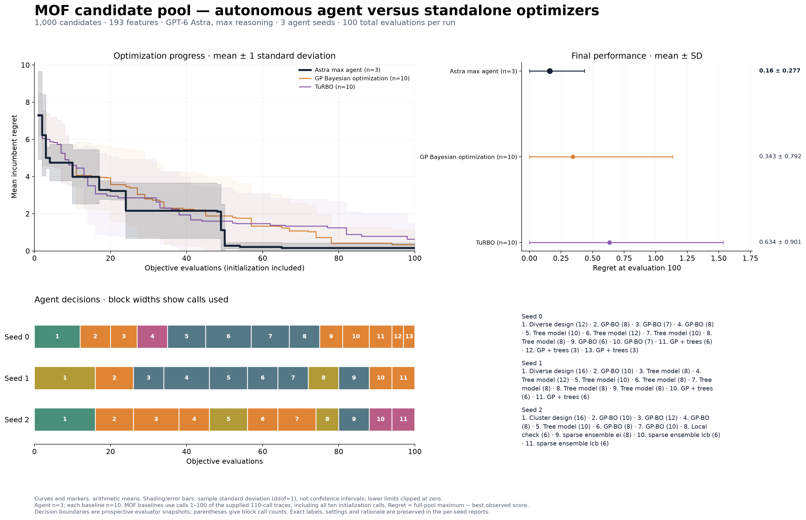

# Materials pool campaigns: Astra max, 100 evaluations, three seeds

**Updated OPV baselines:** [10 shared-random-start runs each for BOBYQA, L-BFGS-B and Nelder–Mead, with regenerated comparison figures](../opv_random_starts_100_20261022/README.md) · [Updated OPV data ZIP](../opv_random_starts_100_20261022.zip). The report below preserves the original supplied midpoint baselines; MOF results are unchanged.

Each campaign uses the current autonomous agent in a fresh isolated Codex CLI, with its own private evaluator and durable 100-call budget. Initialization is included. Seeds 0, 1, and 2 guide stochastic optimization choices; model generation itself is not deterministic.

Source commit: `cbe3886f40e2eeffa002d353188d8ca57a9143cf`. Model: `gpt-6-astra`; reasoning: `max`. No optimizer hints were supplied by the supervisor. One MOF seed-1 attempt was interrupted by a model-service capacity error at 58 calls. At the user’s request it was discarded from the comparison and restarted in a completely fresh CLI with a fresh 100-call budget; none of its observations were passed to the replacement. The completed replacement is the reported seed 1.

Baselines are the colleague-supplied OPV pool results from branch commit `ef1be572e038487dc37a5bd098e5d5d25fab8fb3` and MOF `results_linux.zip`. All supplied baseline rows were checked against the registered private pools, including candidate identity, features (MOF), nearest-untested mapping (OPV), labels and incumbents. The old OPV emulator baselines and short integration smoke tests are not used.

**Equal 100-call budget:** use calls 1–100 of every run. For MOF, discard the final ten calls of the supplied 110-call baseline traces. Their ten random initialization calls remain included in the first 100. The agent chooses its own initialization within the same total allowance.

Curves are arithmetic means of seed-level incumbent regret. Bands and error bars are sample standard deviations (`ddof=1`), not confidence intervals. The agent has three seeds per task; stochastic baselines have ten. OPV BOBYQA, L-BFGS-B and Nelder–Mead have one supplied seed each, so no variability band is estimated for them. Negative mean-minus-SD endpoints are clipped at zero for display. OPV differential-evolution and uniform-box-random traces coincide throughout this 100-call window; both are retained and labelled as supplied.

These detailed campaign reports follow the user’s requested arithmetic mean ± standard deviation and include individual optimizers plus decision timelines. The separate `main/FIGURES.md` paper style uses geometric means ± log-space standard errors; that shared helper and convention are unchanged. Do not confuse the two summaries.

## Task contracts

| Task | Pool | Public information | Private selection/scoring |
|---|---|---|---|
| OPV | 526 measured devices, 11 features | Anonymous [0,1]^11 box; disclosed history dependence | Each query chooses the nearest untested device; response is −PCE. Full features and labels stay private. |
| MOF | 1,000 rows, 193 features (28 constant) | Anonymous feature rows; select an unused integer row index | Response is −raw_y. Unpurchased labels, source IDs and full-pool ranks stay private. |

The MOF archive described 5,882 rows, but the supplied CSV contains 1,000. The registered CSV is byte-for-byte unchanged; no rows were removed or reordered. No physical meaning or units for raw_y were supplied. OPV and MOF have different public interfaces; compare each only with baselines using that task’s same interface, dataset hash, row order, objective sign and total budget.

Reported regret is `full_pool_maximum − best_observed_raw_score`. The full-pool maximum, material/device IDs and ranks are added by trusted reporting after the agent exits. Rank 1 means no pool row has a strictly higher label; ties share rank. For OPV, the best result identifies the purchased device, not a promise that querying its original x again returns the same label.

## Results

| Task | Seed | Calls | Best raw score | Regret | Pool rank | First best call | Decision blocks |
|---|---:|---:|---:|---:|---:|---:|---:|
| mof_pool | 0 | 100 | 9.292830156 | 0 | 1 | 65 | 13 |
| mof_pool | 1 | 100 | 9.292830156 | 0 | 1 | 54 | 11 |
| mof_pool | 2 | 100 | 8.813313117 | 0.4795170389 | 3 | 24 | 11 |
| opv_pool | 0 | 100 | 15.707252 | 0 | 1 | 52 | 8 |
| opv_pool | 1 | 100 | 15.707252 | 0 | 1 | 98 | 9 |
| opv_pool | 2 | 100 | 15.707252 | 0 | 1 | 77 | 10 |

Three seeds describe run-to-run variation; these results alone do not establish statistical superiority over standalone methods.

## Downloadable exports

- [OPV results ZIP](exports/opv_astra_max_100_3seeds_20261022.zip): all three 100-call runs, supplied baselines, mean/SD comparison figures, decision logs and audit records.
- [MOF data and visualization ZIP](exports/mof_astra_max_100_3seeds_for_visualization_20261022.zip): all 300 evaluations, source material IDs and 193 descriptors, best candidates per seed, run evidence and figures. `structure_lookup.csv` identifies SEHTEF and AJOTEY for matching to original crystal structures; CIF files and atomic coordinates were not supplied.

Both archives include their own checksums and README. Their ZIP hashes are also recorded in this report's `sha256.json`.

## Figures

### OPV device pool



[Log-scale comparison](figures/opv_pool/00_complete_comparison_log.png) · [Individual seed curves](figures/opv_pool/02_convergence.png)

[Final regret](figures/opv_pool/01_final_regret.png) · [All decision timelines](figures/opv_pool/03_decision_timeline.png)

Individual timelines: [Seed 0](figures/opv_pool/seed_0_decision_timeline.png) · [Seed 1](figures/opv_pool/seed_1_decision_timeline.png) · [Seed 2](figures/opv_pool/seed_2_decision_timeline.png)

### MOF candidate pool



[Log-scale comparison](figures/mof_pool/00_complete_comparison_log.png) · [Individual seed curves](figures/mof_pool/02_convergence.png)

[Final regret](figures/mof_pool/01_final_regret.png) · [All decision timelines](figures/mof_pool/03_decision_timeline.png)

Individual timelines: [Seed 0](figures/mof_pool/seed_0_decision_timeline.png) · [Seed 1](figures/mof_pool/seed_1_decision_timeline.png) · [Seed 2](figures/mof_pool/seed_2_decision_timeline.png)

Every figure also has PDF and SVG versions. Zero regret is drawn at 1e-8 on log axes and is recorded as exactly zero in the tables. Decision boundaries come from evaluator snapshots captured before the subsequent evaluations, including continuations of a method. Different labels within a single planned block remain in that block.

## Evidence and reproduction

- `summary.csv` and `results.json`: seed-level outcomes.
- `cohort.json`: model, seed, budget, task contracts, source commit and dataset hashes.
- `runs/<task>/seed_<n>/`: original agent trace, scored trace, decisions and snapshots, agent messages, full fresh-context CLI event stream, generated Python code, run manifest and audits.
- `evaluation_journal.json`: exported private evaluation rows; `offline_audit.json`: exact label replay, candidate uniqueness, trace consistency, prospective decision timing and hash checks.
- All six runs must pass their own 28 native isolation checks before any model evaluation. Final audits check that only sandboxed workspace execution tools were used and that there are no evaluations with an unknown outcome. These are tested controls, not a formal guarantee against every OS or runtime vulnerability.
- `sha256.json`: hashes of the exported evidence and figures.

To launch a new campaign from the repository root after the documented environment setup:

```bash
.venv/bin/python main/scripts/run_agent.py --task mof_pool --budget 100 --seed 0 \
  --model gpt-6-astra --effort max
```

Use `opv_pool` for OPV and seeds 0, 1, 2 for three independent campaigns. Never reuse a prior campaign workspace or show an agent this reporting directory. The native runner enforces that separation.

To regenerate the figures from this exported package, run `report.py --render-only` with the repository’s `.agent-venv/bin/python`, then run `comparison_report.py` for the mean/SD baseline comparison figures. `baselines/provenance.json` records supplied sources and the budget truncation rule. Full raw SQLite databases and the frozen source archive are retained in the local ignored cohort directory.
