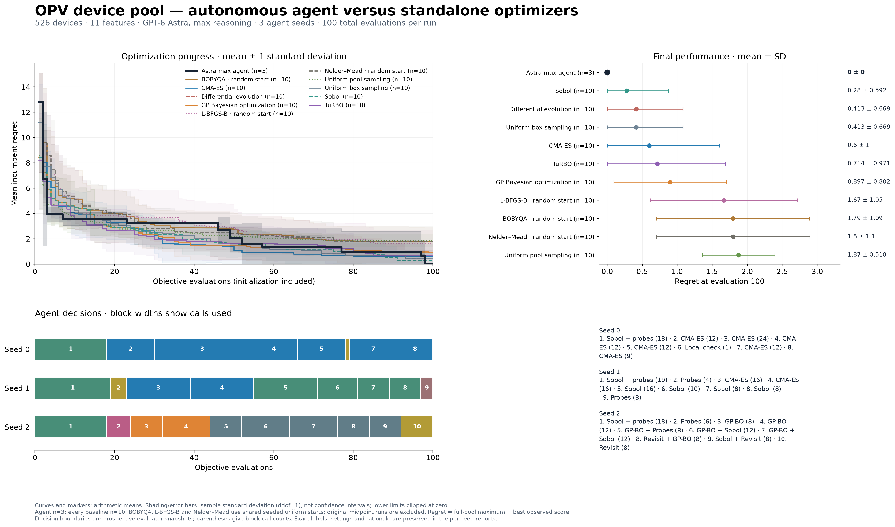

# OPV pool: 10-seed random-start local baselines

Updated comparison for task 006 (`opv_pool`): 526 devices, 11 normalized coordinates, 100 total evaluations per campaign. The three Astra max agent runs are unchanged.

This update replaces the three single-midpoint local baselines **in the comparison figure** with 10 random-start runs each. It retains the seven supplied stochastic baselines (10 seeds each), for 100 baseline runs in the updated plot. The original midpoint data remain separately available and are excluded from these means.



[PDF](figures/opv_pool/00_complete_comparison.pdf) · [SVG](figures/opv_pool/00_complete_comparison.svg) · [Log-scale figure](figures/opv_pool/00_complete_comparison_log.png)

## Experimental protocol

- For seeds 0–9, draw `x0 = numpy.random.default_rng(seed).uniform(0, 1, size=11)`. Use that exact same x0 for BOBYQA, L-BFGS-B and Nelder–Mead at the corresponding seed. The first queried point and purchased device were verified to match across all three methods.
- Use a fresh, complete 526-device pool for every run. Each query purchases the nearest untested device and returns its negative PCE, exactly as in the existing task.
- Count the initial point, finite-difference probes, line searches and repeated coordinates toward the hard 100-call budget. All 30 new runs used exactly 100 calls.
- Preserve repository solver options and tolerances. Run the underlying numerical solver through a budget-enforcing objective callback; do not modify the canonical wrappers. There is no additional restart policy or hyperparameter tuning.
- The 30 new runs finished in about 1.1 seconds of parallel sweep time (excluding validation, imports and figure generation). Four worker processes were used with one numerical-library thread each.

## Results

Regret is the full-pool maximum PCE minus the best observed PCE, in percentage points. Curves, values and error bars use arithmetic means and **sample SD (ddof=1)**. These are not confidence intervals. The agent has 3 seeds and each plotted baseline has 10. Lower error-band endpoints are clipped at zero; the log display uses 1e-8 for zero.

| Method | Runs | Final mean regret | Sample SD |
| --- | ---: | ---: | ---: |
| Astra max agent | 3 | 0.000000 | 0.000000 |
| sobol | 10 | 0.279667 | 0.592423 |
| de | 10 | 0.412666 | 0.669451 |
| random_search | 10 | 0.412666 | 0.669451 |
| cma_es | 10 | 0.600443 | 1.001724 |
| turbo | 10 | 0.714484 | 0.971433 |
| gp_bo | 10 | 0.896817 | 0.801607 |
| L-BFGS-B — random start | 10 | 1.667249 | 1.048887 |
| BOBYQA — random start | 10 | 1.794935 | 1.091763 |
| Nelder–Mead — random start | 10 | 1.798733 | 1.095894 |
| pool_random | 10 | 1.874445 | 0.518471 |

Each random-start local method found the best device in 2/10 runs. Astra found it in 3/3. The original BOBYQA midpoint run reached the best device too; that single result does not describe sensitivity to starting location. Three agent seeds and ten baseline seeds do not establish statistical superiority.

Differential evolution and uniform box sampling retain identical supplied 100-call traces within each seed: DE initializes a population of 110 in this 11-dimensional task, so the 100-call budget ends before mutation and crossover. Neither trace was changed.

## Validation and runtime provenance

`midpoint_adapter_check.json` verifies that replacing the queue-based wrapper with a direct callback reproduces all three current-wrapper midpoint trajectories exactly. `validation.json` independently replays all 10,000 plotted baseline evaluations, checks device identity, exact score, incumbent and budget, verifies 10 distinct trajectories per baseline and the shared starts, and recomputes all 1,100 plotted mean/SD values.

The new local runs use macOS with NumPy 2.4.6, SciPy 1.17.1 and Py-BOBYQA 1.5.0. The supplied stochastic baselines retain their original Linux metadata (NumPy 2.5.4 and SciPy 1.18.1). A current-runtime midpoint control for BOBYQA has a different trajectory from the supplied Linux midpoint trace, but both finish at zero regret. The L-BFGS-B and Nelder–Mead midpoint controls match the supplied traces exactly. These controls are stored separately and excluded from random-start averages. See `midpoint_reference_comparison.json`.

The agent campaigns and their isolation/audit records are copied unchanged. No agent was rerun or shown any new baseline results. Component source and data hashes, seeds, x0 values and solver settings are in `protocol.json`; each new run records its exact runner hash and runtime versions.

## Files and reproduction

- `baselines/opv/opv_pool_pce_d11/`: 100 plotted baseline runs, including 30 new `*_random_start` runs with per-run audits.
- `reference_midpoint/`: three original supplied local runs; `midpoint_controls/`: separate current-runtime validation controls.
- `runs/opv_pool/`: three unchanged agent campaigns, decision logs, generated code and audits.
- `starting_points.csv`: the 10 shared initial coordinate vectors.
- `figures/opv_pool/comparison_curves.csv`: all plotted means and SDs.
- `sha256.json`: package file checksums.

From a clone with the documented `.agent-venv` dependencies, reproduce the experiment in an empty directory inside the repository (existing runs are never overwritten):

```bash
mkdir -p runs/opv-random-start-reproduction
cp main/agent_runs/opv_random_starts_100_20261022/run_random_starts.py runs/opv-random-start-reproduction/
.agent-venv/bin/python -B runs/opv-random-start-reproduction/run_random_starts.py --workers 4
```

To regenerate this exported comparison, run `.agent-venv/bin/python -B main/agent_runs/opv_random_starts_100_20261022/comparison_report.py --task opv_pool`. To replay the observations and check statistics, run the adjacent `validate_report.py`. Neither command performs new optimization campaigns.
